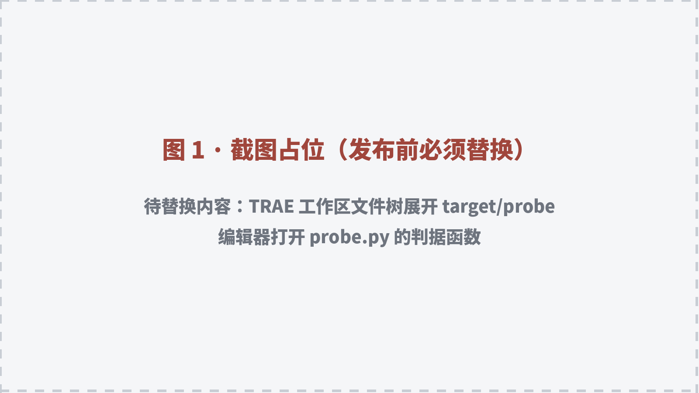
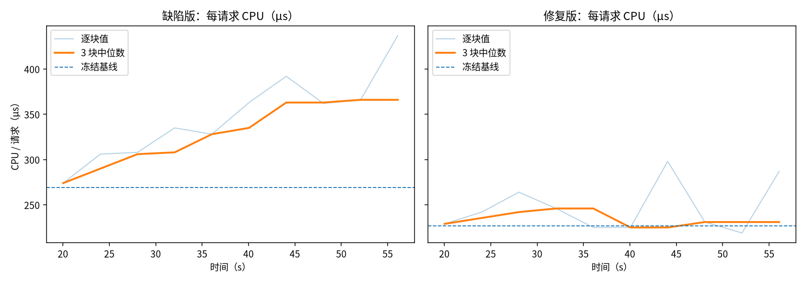
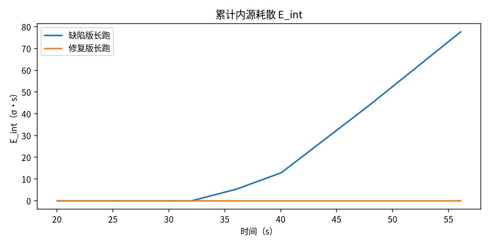
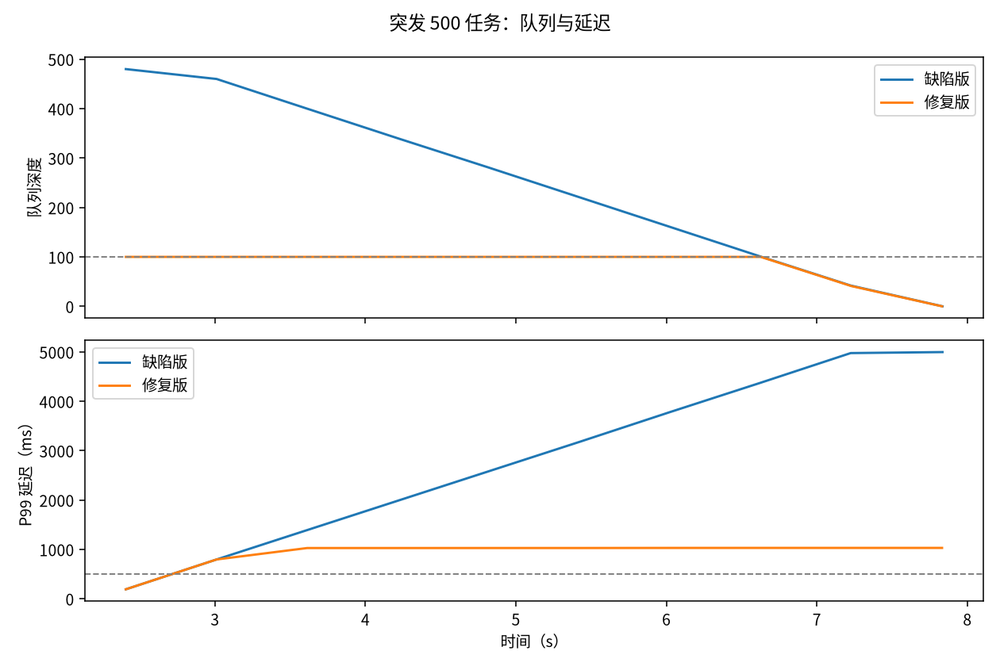
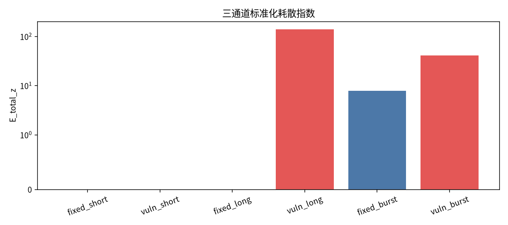

# 短跑测不出，长跑才暴露：我用「资源耗散」定位一个越跑越慢的漏洞

参赛赛道：全链路开发实战

选题方向：从 0 到 1 的全链路开发——用 TRAE 构建一个资源耗散定位工具，验证「短时间测不出、长时间才暴露」的资源型漏洞

话题：#TRAE双端融合 #全新TRAE实战体验

---

同一个日志检索服务，同一套请求，同一个输入分布。

跑 20 秒，三通道耗散指数是 **0**，但判定不是「干净」，而是「窗口不足」——只有两个 4 秒块，连连续三窗都凑不齐，没资格下结论。

跑到 60 秒，指数变成 **138.24**，判定「延续性耗散」。

代码一行没改，变的是运行时间。更具体地说，是历史查询越积越多，每次搜索都要把历史全量扫一遍，CPU／请求从 **265µs** 爬到 **405µs**（末窗两轮均值），峰值 **437µs**。

这不是「感觉变慢了」，是算出来的。

## 一、为什么修完一个漏洞，又长出一个

做漏洞挖掘的人大概都遇到过这种循环：补丁把眼前的问题压下去，过一段时间，另一个问题浮上来。原因之一是我们只看了「当下这一刀」——请求这一秒的 CPU、这一次的延迟、这一版的扫描结果，却没看系统跑久了会漂到哪里。

我这次的假设有四条，先摆明，全部是待验证的命题，不是结论：

1. 观测是短暂性的：启动阶段的一次跳转是正常现象；只有延续性的偏差才算漂移。
2. 短时间运行看不出系统性漂移；漂移要累积到超过基线，才会被观测到。
3. 内源漂移会被 CPU 捕捉：同样的有效功，花的 CPU 越来越多。
4. 外部损耗不在 CPU 里，在队列、丢弃和延迟里，必须靠背压指标看。

如果这四条成立，那么「修漏洞又出新漏洞」的一个可能解释是：修复只压住了当前窗口的指标，没有压住另一个通道的耗散。

## 二、三通道耗散怎么算

先定一条纪律：**基线冻结**。

启动后先空转 4 秒避开启动瞬态，再取一段基线：短跑取 8 秒（2 个 4 秒块），长跑取 16 秒（4 个块），算中位数和 MAD（绝对中位差），之后不再更新。用 EWMA 自适应看起来更稳，但它会把真正的漂移当成「概念漂移」吸收掉——系统慢慢变坏，基线也跟着慢慢变坏，最后永远不报警。这是我在实现时踩到的第一个坑。

三个通道：

**内源漂移 E_int**

```
z_cpu = (CPU/请求 - 基线) / MAD
E_int = ∫ max(0, median3(z_cpu) - 3) dt
```

要求连续 3 个 4 秒块的中位数都超过 3σ，才算漂移。单点尖刺不算。

**电子泄漏 E_leak**

物理层的说法是：电子在器件间转移时，一部分没完全通过，以热、等待、重试的形式释放到系统外。软件层测不到电子，我用的代理是「有效功转化率」：

```
泄漏 = max(0, 实际CPU秒 - 有效功 × 基线每功CPU秒)
E_leak = Σ 泄漏
```

它回答的是：这一段时间里，有多少 CPU 秒没有变成完成的请求。这是代理量，不是电子数，文中所有「电子泄漏」都按这个定义读。

**外部损耗 E_ext**

```
E_ext = ∫ [ max(0, 队列深度/容量 - 0.5)
          + 丢弃率
          + max(0, P99/500ms - 1) ] dt
```

队列、丢弃、P99 三个指标一起看，避免「队列没满就以为没事」。

**判据一：瞬态、延续、无法判定**

指数本身不直接等于漏洞。每个观测段先过四道门：

| 判定 | 条件 | 含义 |
|---|---|---|
| 窗口不足 | 有效测量窗少于 3 个 4 秒块 | 短跑，不下结论 |
| 基线不稳 | 基线 MAD／中位数 > 10%，或极差 > 40% | 基线被启动噪声污染，不硬给 0 |
| 仅瞬态 | 有单窗 z > 3，但没有连续 3 窗成立 | 启动跳变、调度尖刺，属正常现象 |
| 延续性耗散 | 连续 3 窗的中位数 z > 3 | 才判为漂移 |

短跑 20 秒落到「窗口不足」，不是因为它干净，而是因为它不够长。修复版长跑也出现过 298µs、314µs 的单窗跳变，判据只记「仅瞬态」，不升级成漂移。

**判据二：背压有没有生效**

外部损耗不能只看队列深度，还要看生产端有没有被反压：

- **无负载**：这一段没收到任务，不判。
- **背压靠拒绝**：拒绝率超过 1%，用丢弃换稳定。
- **背压生效**：生产端出现阻塞，且队列贴着容量（≥90%）。如果出队等待仍超 SLA，说明背压生效但容量或消费者不足。
- **无背压**：队列贴着容量，但生产端从未阻塞——说明队列是无界的，损耗会一直堆下去。
- **轻背压**：生产端有阻塞，但队列没贴容量。
- **无压力**：队列没贴容量，生产端也不阻塞。

这不是六个新指标，是对同一组指标的判定规则。

最后合成：

```
E_total_z = z_int + z_leak + z_ext
```

三个通道各自对正常基线标准化，再相加。正常基线取自修复版短跑的多轮结果；方差为 0 时给固定底噪，避免指数发散。

## 三、过程：先定判据，再写代码

我没有拿真实项目当靶子，而是新做了一个最小靶场，缺陷是故意留的：

- `/search`：每次请求把历史查询全量扫一遍，复杂度 O(n)。历史越长，单次请求越慢。
- `/burst`：突发任务进入无界队列，消费速度小于生产速度，队列无限堆积。
- 修复版：搜索改成增量聚合 O(1)；队列改成有界 + 阻塞背压。

工具分三块：

- `target/server.py`：靶场，可切换缺陷版／修复版
- `probe/probe.py`：每 0.5 秒采一次 CPU、RSS、IO、队列、丢弃、P99，并按 4 秒聚块
- `run_all.py`：跑短跑／长跑／突发／修复四组条件，出表出图

项目在同一个 TRAE 工作区里推进：拆任务、改代码、跑实测、回看结果，没有换工具。顺序是先判据、后实现——先把四条假设写成可被数据否掉的命题，再确定靶场接口和观测字段，最后才写探针。写完不算收工，而是拿同一套判据反复打自己：单点尖刺误报、EWMA 吃掉漂移、基线被启动噪声污染，都是这样打出来的，细节放在第六节。



*图 1：在 TRAE 中打开靶场与探针：左侧文件树展开 target/probe，编辑器打开 probe.py 的判据实现*


*图 2：判据实现与重跑：编辑器里的连续三窗判定，终端里这次 60 秒观测的 verdict 与 E_int*


*图 3：运行产物：results/matrix/summary.md 的四组条件汇总，以及生成的图表*

## 四、实测结果

| 条件 | 判定 | 背压 | E_int | E_leak | E_ext | E_total_z | 峰值队列 | 峰值 P99 |
|---|---|---|---:|---:|---:|---:|---:|---:|
| 修复版短跑 20s | 窗口不足 | 无负载 | 0 | 0 | 0 | 0.00 | 0 | 0ms |
| 缺陷版短跑 20s | 窗口不足 | 无负载 | 0 | 0 | 0 | 0.00 | 0 | 0ms |
| 修复版长跑 60s | 仅瞬态 | 无负载 | 0 | 0 | 0 | 0.00 | 0 | 0ms |
| 缺陷版长跑 60s | 延续性 | 无负载 | 81.09 | 0.0571 | 0 | **138.24** | 0 | 0ms |
| 修复版突发 500 | 延续性 | 背压生效 | 0 | 0 | 7.87 | 7.87 | 100 | 1031ms |
| 缺陷版突发 500 | 延续性 | 无背压 | 0 | 0 | 40.71 | **40.71** | 480 | 4997ms |



*图 4：同一服务，缺陷版每请求 CPU 从 269µs 爬到 437µs（两轮末窗均值 405µs）；修复版在基线附近波动，只出现单窗瞬态*

短跑 20 秒，缺陷版也是 0，但判定是「窗口不足」：两个 4 秒块，凑不齐连续三窗。不是因为它没问题，而是这一段时间不够下结论。长跑 60 秒，E_int 才越过阈值。**短跑是抽样，长跑才是分布。**

60 秒里，E_leak 是 0.0571 CPU·秒，占该段总 CPU 的 **18.6%**。也就是说，接近五分之一的 CPU 没有变成有效请求，而是花在了重复扫描历史。



*图 5：前 20 秒是启动与基线段，E_int 恒为 0；缺陷版约 32 秒后才开始累积，最后一段斜率变陡；修复版整段贴地*

这张图比前面的数字更说明问题：**耗散不是一发生就被看见的，它先是 0，然后才开始累积。** 如果观测只覆盖前 20 秒，曲线还没离开 0，结论只能是「窗口不足」。修复版的曲线全程贴地，但它也不是「证明干净」，只是这 60 秒里没有连续三窗越过阈值。



*图 6：缺陷版队列冲到 480、P99 到 5 秒；修复版队列压在 100、P99 约 1.03 秒*

## 五、定位到了哪里

工具不是只给一个总分，它把异常窗口里的函数级 CPU 增量排了序：

- `handle_search`：53%
- `scan_history`：47%

对应的建议：

- `scan_history`：全量历史扫描 O(n)，改为增量聚合或索引，别在请求路径里遍历历史
- `handle_search`：把统计从请求路径移出，改为维护计数器

突发场景不再只按 CPU 排序，而是先判背压。缺陷版判「无背压」：500 个任务全部收下，生产端 0 次阻塞，队列一路涨到 480，出队等待平均 2514ms/任务。建议的第一句不是「加并发」，而是「先补有界队列」。修复版判「背压生效」：入队阻塞 399 次、每任务平均阻塞 8ms，队列压在 100，但出队等待仍 915ms/任务、P99 1031ms，所以建议是降容量或加消费者。



*图 7：短跑为 0，长跑 138.24，突发 40.71；修复后长跑归零，突发仍有 7.87 的残留*

## 六、四个踩坑，比结果更有用

**坑一：单点 CPU 尖刺被当成漂移。**

第一版用均值 + 标准差，修复版长跑也报出 E_int=13.2。回看序列，是 t=34.6s 一个单点 z=6.5，后面立刻回落。改成中位数 + MAD，再要求连续 3 个块成立，修复版不再判漂移。所谓「电子间的小误差」，必须先被压住，否则它会把所有结论带偏。

**坑二：自适应基线会把真漂移吃掉。**

EWMA 的 α=0.05 看起来很稳，但长跑时基线跟着 CPU 一起上移，漂移永远追不上阈值。改成冻结基线后，同样的 60 秒才暴露出 81.09 的内源耗散。

**坑三：背压修掉了堆积，没修掉延迟。**

修复版突发把队列从 480 压到 100，但 P99 仍是 1031ms，超过 500ms 的 SLA，E_ext 还有 7.87，不是 0。原因是队列容量 100、单任务 10ms，排队本身就接近 1 秒。**修掉一个通道的耗散，不等于修掉全部通道。** 这正是「修漏洞又出新漏洞」在数据里的样子。

**坑四：基线自己也会被启动噪声带偏。**

长跑基线一开始只取 8 秒，也就是 2 个 4 秒块。有一次缺陷版 60 秒跑完，CPU/请求从 285µs 涨到 375µs，本该报警，却因为两个基线块相差 14.7%，MAD 被抬到中位数的 10.9%，被判成「基线不稳」。工具没有误报，但也没敢下结论。把长跑基线延长到 16 秒（4 个块）后，同一条缺陷稳定判为延续性耗散。另一边，修复版长跑出现 298µs、314µs 的单窗跳变，判据只记「仅瞬态」。**启动阶段的一次跳转是正常现象；但基线如果被它污染，就会把后面的真漂移一起吃掉。**

## 七、拿真实 CVE 复测

靶场是自造的，这是最容易被质疑的地方。所以补了一个真实漏洞：CVE-2023-46136，Werkzeug 3.0.0 的 multipart 解析缺陷——文件内容以 CR/LF 开头、后面跟着一大段不含 CR/LF 的数据时，解析器逐块向内部缓冲区追加并反复查找边界，CPU 随数据量超线性增长；3.0.1 修复。

复测用的是最小 WSGI 服务，只做一件事：解析上传的 multipart 并读文件。载荷 8MB，基线段用同样大小、但每 8KB 带换行的正常内容，观测段换成触发载荷，每秒 1 次，每 4 秒聚块，判据完全不变。

| 版本 | 基线 CPU/请求 | 观测段 CPU/请求 | z 范围 | verdict |
|---|---:|---:|---:|---|
| 3.0.0 | 11.99ms | 286.4–299.4ms | 457.9–479.5 | sustained |
| 3.0.1 | 13.07ms | 11.9–12.6ms | -1.8–-0.7 | clean |

两个结论。

第一，修复可以被同一套判据复测：3.0.1 回到基线，z 在 -1.8 到 -0.7 之间，判 clean。

第二，这个 CVE 不属于「越跑越慢」。它每一次请求都贵——基线一建立，第一个 4 秒块就已经 z=479，短跑同样能抓到。所以工具判 sustained，含义是「延续性偏离基线」，不是「随时间加剧」。**短跑测不出的是累积型漂移，不是所有资源漏洞。** 这一点不写清楚，工具就会被当成万能检测器。

## 八、自己写判据，再攻击自己的修复

修复版 CPU 归零，不等于漏洞修完。所以我给这个漏洞写了一份自签记录（编号是自签的，不是官方 CVE），把「修好」定义成五条可被攻击的判据：

| 判据 | 通过条件 |
|---|---|
| G1 功能等价 | 同一查询序列，修复前后每次返回值一致 |
| G2 CPU 不漂移 | 8s 预热后 16s 内，末两窗 CPU/请求 ÷ 首两窗 ≤ 1.2 |
| G3 内存有界 | 10000 次请求后 RSS 增长 ≤ 2MB |
| G4 尾延迟 | 2000 次请求 P99 ≤ 50ms |
| G5 长跑等价短跑 | 10s 预热后 180s 内，末三窗 CPU/请求 ÷ 首三窗 ≤ 1.2 |

G5 是算法判据：只有让第 180 秒的每请求代价和第 12 秒一样，才算把长运行拆成了短运行，而不是靠超时或限流把指标压下去。

这里要分清两件常被混为一谈的事：**有人盯着、有限流、有告警，不等于修好。** 那只是把暴露窗口压小——请求被拒绝、超时提前返回、扫描线程留在后台继续跑，指标好看了，代价还在。判据该问的不是「有没有出事」，而是「每请求代价还依不依赖历史长度」：依赖，说明长运行只是被看住了；不依赖，才是算法层面的修复。想让它不出漏洞，只有把长运行变成短运行这一条路，而这条路只能靠改算法，改不了就只是赌负载不够大。

这条判据有区分力：同一条件下，缺陷版 180 秒的每请求 CPU 从 244µs 单边爬到 2073µs，45 个窗口没有一次回落，末三窗/首三窗 = **6.818**，判失败；第二版修复是 0.964。

然后拿这五条去打第一版修复：

| 判据 | 第一版修复 | 第二版修复 |
|---|---|---|
| G1 功能等价 | 300/300 不一致 | 0/300 |
| G2 CPU 不漂移 | 0.992 | 1.040 |
| G3 内存有界 | +12KB | 0KB |
| G4 尾延迟 | 0.201ms | 0.194ms |
| G5 长跑等价短跑 | 1.053 | 0.964 |
| 总判定 | **漏洞没修完** | 全部通过 |

第一版把 O(n) 扫描改成只累加 `total_len`。CPU 确实变成 O(1)，G2、G5 都过，但返回值也变了：缺陷版返回「历史总长度 + 首字符匹配数」，修复版只返回总长度。300 次请求，300 次不一致。**性能指标全绿，功能已经坏了。** 这就是「修一个洞，长一个洞」最典型的形态。

第二版补了首字符计数字典，仍然是 O(1)，同一序列 0 次不一致。180 秒、45 个窗口，末三窗/首三窗 = 0.964，长跑后段和短跑前段同价。这不是调参调出来的，是把「每请求代价依赖历史长度」换成了「只依赖常数级聚合」。

这里必须说清楚：这五条判据覆盖的范围内，可以认为修好了；范围外（并发竞态、跨接口组合、长时间内存碎片）不保证。所谓「保证以后不出漏洞」，只能相对于一张写死的判据表成立。判据越具体，别人越能拿它来攻击你——这比口头宣布「已修复」可靠。

## 九、这份结果不能证明什么

必须写清楚：

- 主靶场是我自己造的；真实 CVE 只用最小 WSGI 调用面复测了单条解析路径，不是完整业务系统，也不能直接外推到生产项目。
- 当前机器没有 `perf`、没有 RAPL，测不了 CPI 和真实能耗；「电子泄漏」只是有效功转化率的代理。
- 这次只跑了「运行时长」轴，没有跑「代码规模」轴。两条轴都重要，但后者还没数据。
- 定位粒度是函数级，不是行级。
- 短跑的 0 是「窗口不足」，不是「没有耗散」；它不能用来证明系统干净。
- 修复版长跑仍有一次单窗瞬态，只能说明这组负载下没有延续性漂移，不等于永远不漂。
- 判定依赖基线质量；基线不稳时工具会拒绝下结论，这种「无法判定」本身也是结果，不能读成 0。
- 自签的五条判据只覆盖搜索接口的语义、CPU、内存、尾延迟与长跑不变性；并发竞态与跨接口组合不在里面，不能被读成「整体安全」。

## 十、复现

```bash
python3 run_all.py --quick   # 约 8 分钟，短跑 20s / 长跑 60s
python3 run_all.py           # 约 14 分钟，短跑 45s / 长跑 120s
```

单次观测：

```bash
python3 probe/probe.py --mode search --duration 60 --rate 100
python3 probe/probe.py --mode search --duration 60 --rate 100 --fixed
python3 probe/probe.py --mode burst --n 500 --duration 15
```

真实 CVE 复测（需要两个独立环境）：

```bash
python3 -m venv /tmp/venv-300 && /tmp/venv-300/bin/pip install werkzeug==3.0.0
python3 -m venv /tmp/venv-301 && /tmp/venv-301/bin/pip install werkzeug==3.0.1
python3 real_cve/run_cve.py --python /tmp/venv-300/bin/python --label vuln_300
python3 real_cve/run_cve.py --python /tmp/venv-301/bin/python --label fixed_301
```

自签判据攻击：

```bash
python3 cve/attack.py --label v1 --v1 --long   # 第一版修复，G1 应失败
python3 cve/attack.py --label v2 --long        # 第二版修复，应全部通过
python3 cve/g5_ref.py                          # 缺陷版负对照，G5 应失败
```

---

主靶场证明了三件事：短跑没资格判，长跑能判，修复后要用同一套判据复测。第八节又补了第四件：修好还必须能被攻击证伪。真实 CVE 那次补了一条边界：这套判据抓的是延续性偏离，不是所有资源漏洞。

也没有证明它对真实业务项目同样有效——CVE 那次复测的只是一条解析路径，不是完整系统。下一步该做的，是把「代码规模」轴补上，再拿一个真实仓库跑一遍——如果那时 E_int 仍然能把延续性漂移从启动瞬态里分出来，背压判据也能落在真实队列上，这套方法才值得继续往下走。

## 十一、附录：原始记录与代码

源码、逐次观测 JSON、汇总表与全部图表：

`https://github.com/JTE-V/dissipation-locator`

下表字段直接取自 `results/matrix/summary.json`，未做二次加工。每组两轮，E 为两轮算术平均，峰值为两轮最大；`verdict` 与 `bp_verdict` 是探针原始输出。

| 组 | 轮数 | verdict | bp_verdict | E_int | E_leak | E_ext | z_int | z_leak | z_ext | E_total_z | 峰值队列 | 峰值 P99(ms) | 丢弃 |
|---|---:|---|---|---:|---:|---:|---:|---:|---:|---:|---:|---:|---:|
| fixed_short | 2 | insufficient_window | no_load | 0 | 0 | 0 | 0 | 0 | 0 | 0.00 | 0 | 0 | 0 |
| vuln_short | 2 | insufficient_window | no_load | 0 | 0 | 0 | 0 | 0 | 0 | 0.00 | 0 | 0 | 0 |
| fixed_long | 2 | transient_only | no_load | 0 | 0 | 0 | 0 | 0 | 0 | 0.00 | 0 | 0 | 0 |
| vuln_long | 2 | sustained | no_load | 81.0932 | 0.0571 | 0 | 81.09 | 57.15 | 0 | 138.24 | 0 | 0 | 0 |
| fixed_burst | 2 | sustained | backpressure_blocking | 0 | 0 | 7.8656 | 0 | 0 | 7.87 | 7.87 | 100 | 1030.48 | 0 |
| vuln_burst | 2 | sustained | no_backpressure | 0 | 0 | 40.7074 | 0 | 0 | 40.71 | 40.71 | 480 | 4996.98 | 0 |

逐轮原始文件在 `results/matrix/`，每轮都保留了 0.5 秒采样序列与 4 秒测量块，可以自己重算上面的每一个数字。

真实 CVE 复测的原始输出在 `results/real_cve/`：`vuln_300.json` 基线 11.989ms、观测段 286.4–299.4ms、verdict=sustained；`fixed_301.json` 基线 13.074ms、观测段 11.9–12.6ms、verdict=clean。

自签判据的攻击记录在 `results/cve/`：`attack_v1.json` 四项里 G1 失败（300/300 不一致），`attack_v2.json` 四项全过。判据原文在 `cve/TRG-2026-0001.md`，攻击脚本 `cve/attack.py --label v1 --v1` 可复现第一版修复的失败。
